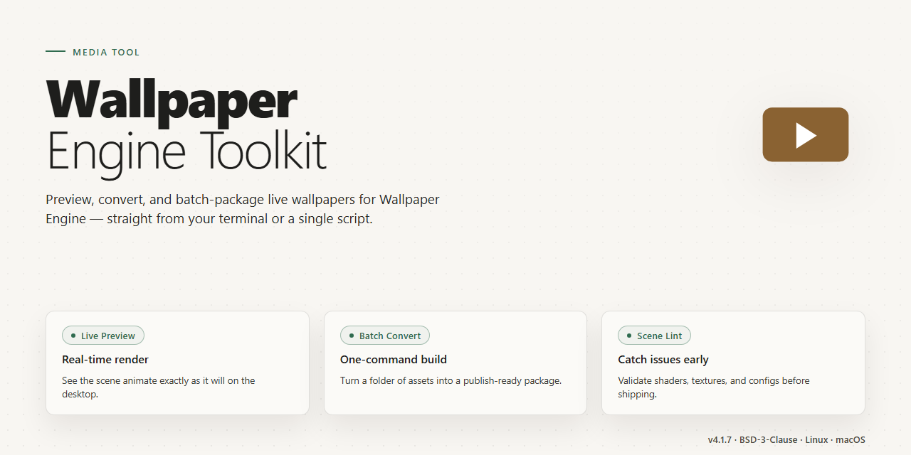

# 🎨 Engine Toolkit — Visual Workflow Media Editor

### 💻 PowerShell Installer

   

---

Engine Toolkit turns a chaotic library into a deliberate visual system — one canvas where backgrounds, stills, gaming themes, and multi-monitor layouts live side by side. Organize collections into categories and favorites, bind them to PC profiles, then flip between workstation and gaming setups without breaking your desktop flow. Android collections and performance presets round out the picture, so every screen you own inherits the same intentional aesthetic.

## ✅ Before You Start

- **OS:** Windows 10 / 11
- **Shell:** PowerShell 5.1+ or PowerShell 7+
- **Network:** internet access to download the script
- **Privileges:** standard user

## Features

🎞️ ** Library, Curated by Vibe** — File every background into themed shelves so the right mood is always one glance away: deep space, neon cyberpunk, soft anime, racing, wilderness, midnight dark, clean minimal, city glow, abstract flow.
- 🖼️ **Resolution-Aware Collections** — Group by the display they belong to — Full HD, 1440p, ultrawide,, vertical — and keep each monitor's collection distinct instead of tangled in one folder.
- 🎮 **Game-Matched Desktop Profiles** — Save a full desktop identity per title: a competitive layout for shooters, an MOBA theme, a dark survival setup, a pixel-style desktop, a neon configuration. Switch the whole look in one move.
- 🖥️ **Multi-Monitor Layout Builder** — Compose layouts for one, two, three, or ultrawide setups — primary and secondary displays,, resolution, position, theme, and profile all captured together. Store as many workstation and gaming configurations as you need.
- ⚙️ **Performance Presets for Every Machine** — Quality for high-end rigs, Balanced for everyday use, Performance for lightweight desktops, Battery for laptops — pick the visual intensity that fits the moment.
- 📱 **Android Collections, Kept Separate** — Organize mobile backgrounds on their own track —, resolution, orientation, category, favorite status, device profile — so phone and desktop libraries never blur together.
- 🎨 **Theme Composer** — Blend, desktop theme, layout, and monitor profile into presets like Gaming, Work, Anime, Minimal, Dark, Neon, Relax, or something entirely custom.
- ❤️ **Ratings & Favorites** — Star from one to five and filter the whole library by rating, category, resolution, or profile to surface exactly what fits.
- 📂 **Metadata-First Organizer** — Every carries its own card: title, resolution tier, static or, category, theme, monitor, rating, favorite flag — organized by design, not by guesswork.
- 📊 ** Dashboard** — A single visual control surface: Library (, static,, favorites), Display (resolution, monitor, ultrawide, multi-monitor), Themes (gaming, anime, nature, minimal), Mobile (Android, portrait, collections, favorites), Performance (quality, balanced, performance, battery), and Profiles (gaming, work, desktop, custom).

## How it works

Start by thinking in layers, the way the toolkit itself does. At the top sits the **library layer**: every you add gets a home, whether it's a looping scene, a crisp still, or a vertical phone background. Each entry carries its own little identity card — title, resolution, type, category, monitor target, rating — so nothing ever gets lost in a nameless folder again. Tag a piece as *New*, promote it to *Favorite*, mark it *Active*, and retire it to *Archived* when your taste moves on.

Beneath the library sits the **profile layer**, and this is where the real magic happens. A profile is a complete desktop snapshot: a choice, a theme, a layout, a monitor arrangement, and a performance preset, all bundled into one switchable package. Build a neon-soaked gaming profile for late-night sessions, a calm minimal setup for focused work, and a battery-friendly configuration for when you're unplugged — then flip between them in a single move. Multi-monitor users get their own canvas: define primary and secondary displays, assign a to each, set resolutions and positions, and save the whole arrangement as a named workstation layout.

The **performance layer** keeps everything honest. Rather than assuming every machine can push maximum animation quality, the toolkit lets you dial in presets — Quality for powerhouse rigs, Balanced for everyday use, Performance for lighter hardware, and Battery for laptops on the go. Each preset travels with its profile, so switching from a gaming setup to a travel setup adjusts more than just the visuals.

Finally, the **collection layer** ties it together across devices. Android backgrounds live in their own dedicated space with orientation, device profile, and favorite tracking kept separate from your desktop catalog, while backup and restore keep every profile, layout, and collection safe. The dashboard is the front door to all of it — glance at library counts, display configurations, theme groupings, mobile collections, performance states, and saved profiles, and jump straight to whatever needs your attention. Add a, shape a profile, save a layout, repeat — and watch your desktop become something you actually designed.

## Workflow

The toolkit is built around a simple rhythm: **see it, shape it, save it.** Everything flows through a visual library that behaves less like a file manager and more like a mood board for your desktop.

**1. Build the library.** Drop into the Library or the Collection. Each piece gets tagged — category, resolution, monitor, static or — so the dashboard can slice the collection any way you like. Space, Cyberpunk, Anime, Minimal: the grid rearranges itself around whatever you're hunting for.

**2. Shape the display.** Move into the Multi-Monitor Manager and lay out your screens the way you actually use them. One monitor for focus, two for flow, three for full immersion, ultrawide for the cinematic spread. Assign a, resolution, position, and theme to each display, then save the whole arrangement as a layout.

**3. Tune the machine.** Pick a Performance Profile — Quality for a high-end rig, Balanced for everyday use, Performance for a lean desktop, Battery for the laptop on the move. The toolkit adjusts how much visual weight each profile carries, so the animation never fights the work.

**4. Bundle it into a theme.** Combine, desktop theme, layout, and monitor profile into a single preset. Gaming, Work, Anime, Minimal, Dark, Neon, Relax — one click swaps the entire atmosphere, not just the background.

**5. Keep mobile in the loop.** The Android Collection mirrors the same logic for phones:, resolution, orientation, category, favorite flag, device profile. Desktop and mobile stay organized side by side, never tangled together.

**6. Rate, filter, refine.** Favorites get a star rating from one to five. The dashboard's LIBRARY, DISPLAY, THEMES, MOBILE, PERFORMANCE, and PROFILES panels all read from the same metadata, so filtering by rating, category, resolution, or profile always lands on the same clean result.

**7. Back it up, carry it forward.** Profile Backup preserves your library, layouts, and presets as a portable bundle — move to a new machine, restore the whole visual setup, and pick up exactly where the last desktop left off.

The loop closes there: every new, every new monitor, every new mood feeds back into the library, and the library feeds back into the next preset. The desktop stops being a static image and becomes a collection you keep curating.

## FAQ

**Q: Is Engine Toolkit a engine itself?**
No — it's the control room, not the projector. The toolkit doesn't render animations or push pixels to your screen; it organizes, profiles, and manages the and layouts you already use. Think of it as the librarian for your visual library, not the library itself.

**Q: How does the workflow actually feel?**
Import → Tag → Categorize → Profile → Deploy. Drop your into the library, stamp them with resolution, type, monitor, and rating, then bundle them into profiles: a gaming preset for your ultrawide, a calm minimal setup for focused work, a neon-lit collection for late nights. Switch configurations the way you'd flip between scenes in a film — one click, whole desktop mood changes.

**Q: Can I run different layouts on different monitor setups?**
That's the heart of it. Save a single-monitor profile, a dual-monitor arrangement, a triple-display battlestation, and an ultrawide sanctuary — each with its own, resolution, position, and theme assignments. Move between workstations and the toolkit remembers which canvas belongs to which screen.

**Q: What's the difference between the PC profiles and the Android collections?**
Two separate galleries, one toolkit. Desktop profiles handle multi-monitor complexity, performance tiers, and theme stacking. Android collections keep mobile backgrounds organized by device, orientation, and favorite status — so your phone's rotation doesn't scramble your collection. Same organizational language, different canvas.

**Q: How do performance profiles fit into the picture?**
They're the dimmer switch. Quality mode lets your high-end rig breathe; Balanced splits the difference; Performance keeps things light; Battery mode respects your laptop's endurance. Pair them with themes and the toolkit scales the visual ambition to match the hardware's mood.

**Q: Where do favorites and ratings live?**
Right inside the library, layered on top of everything else. Star-rate from one to five, mark favorites, then filter across category, resolution, type, monitor, or profile. Your five-star space for the ultrawide? One filter away.

**Q: Can I really mix + theme + layout + monitor into a single preset?**
Yes — that's the Desktop Theme Manager's whole trick. Stack a, a desktop theme, a monitor layout, and a performance profile into one named preset. Save it as "Gaming," "Work," "Anime," "Minimal," "Dark," "Neon," "Relax," or whatever label fits your workflow. Presets are the toolkit's vocabulary; you're just writing the sentences.

**Q: What kinds of can I catalog — static,, both?**
Both, side by side. The library tracks type, resolution, category, rating, and display assignment for every entry. get their own categories; static collections get theirs. The organizer doesn't play favorites — it files them.

**Q: Is there a backup for my profiles?**
Profile Backup is built in. Your configurations, collections, ratings, and layouts are yours to preserve — snapshot them before rearranging your desktop, or archive a setup you loved before experimenting with a new one.

**Q: How is the toolkit organized day to day?**
Through the Dashboard — a single view split into Library, Display, Themes, Mobile, Performance, and Profiles. Each panel is a lens on the same collection: browse sets in Library, check resolution assignments in Display, audition presets in Themes, and confirm your mobile catalog in the Android panel. One toolkit, six angles.

**Q: Does it handle ultrawide and vertical displays?**
Explicitly. Resolution Manager covers Full HD, 1440p,, ultrawide, and vertical orientations, and the Multi-Monitor Manager assigns each display its own, resolution, and position. Portrait monitors get portrait collections; ultrawides get their own bins — no compromises, no stretched.

**Q: What's the ideal first move for a new user?**
Start with one profile. Pick a category — say, Cyberpunk — drop a handful of in, rate them, assign them to your primary display, and save the configuration as a preset. Once that loop feels natural, layer in a second monitor or a mobile collection. The toolkit rewards small, deliberate curation over bulk importing — the workflow is the point, not the volume.

## License

The Engine Toolkit is released under the MIT License — a deliberately open, deliberately simple choice for a tool built around visual freedom. Think of it as the canvas beneath the: you get the full picture, no watermarks, no hidden layers.

**What you can do:**

- 🖌️ **Use it freely** — run the toolkit on any machine, for personal desktops, workstation setups, or gaming rigs, without asking permission.
- 🎨 **Remix it** — modify the source, rearrange the dashboard, retheme the interface, and tailor profiles to your exact multi-monitor workflow.
- 📦 **Share it** — redistribute your own builds, bundle it into your setup guides, or hand it to a friend who's still manually swapping.
- 🖥️ **Deploy it** — integrate the toolkit into your own desktop-customization projects or internal tooling.

**What we ask in return:**

- 📜 **Keep the notice** — the original copyright line and this license text must travel with any copy or substantial portion of the toolkit.
- 🏷️ **Credit the source** — if you build something visible on top of it, mention where the foundation came from.
- 🚫 **No false endorsement** — don't imply the original authors back your fork, your distribution, or your modifications.

**The fine print, in plain sight:**

> THE SOFTWARE IS PROVIDED "AS IS", WITHOUT WARRANTY OF ANY KIND, EXPRESS OR IMPLIED, INCLUDING BUT NOT LIMITED TO THE WARRANTIES OF MERCHANTABILITY, FITNESS FOR A PARTICULAR PURPOSE AND NONINFRINGEMENT. IN NO EVENT SHALL THE AUTHORS OR COPYRIGHT HOLDERS BE LIABLE FOR ANY CLAIM, DAMAGES OR OTHER LIABILITY, WHETHER IN AN ACTION OF CONTRACT, TORT OR OTHERWISE, ARISING FROM, OUT OF OR IN CONNECTION WITH THE SOFTWARE OR THE USE OR OTHER DEALINGS IN THE SOFTWARE.

**A note on scope:** Engine itself is a separate product with its own terms. This license covers the Toolkit — the organizer, the profile manager, the layout engine — and nothing else. Desktop themes you create with it belong to you.

**Why MIT?** Because a toolkit about visual self-expression shouldn't lock the door behind you. Fork it, theme it, ship it — just keep the light on for whoever comes next.